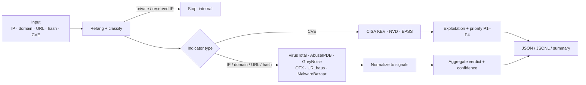

# threat-intel-enrichment

[](https://github.com/parijat007/threat-intel-enrichment/actions/workflows/tests.yml)


This tool enriches indicators (IPs, domains, URLs, file hashes) and CVEs from several free threat-intelligence sources at once. It returns one normalized JSON verdict per indicator. The output is shaped to drop straight into a SOAR playbook, a SIEM enrichment step, or a tool call from a local LLM agent.

```console
$ python3 ioc_enrich.py --format summary 8.8.8.8 hxxps://bad[.]example/x CVE-2024-3400
ipv4 8.8.8.8: BENIGN (0 malicious, 0 suspicious, 3 benign of 4 sources answering); tags: Google Public DNS, riot, ...
url https://bad.example/x: MALICIOUS (2 malicious, 0 suspicious, 0 benign of 3 sources answering); tags: malware_download, ...
CVE-2024-3400: IN CISA KEV; CVSS 10.0; EPSS 94.00% (p100) -> P1.
```
*Illustrative output. Actual results depend on live provider data and the keys you configure.*

---

## Why

Triage usually means checking the same indicator in four or five browser tabs, then reconciling verdicts that use different scales. This tool:

- **Runs the lookups in parallel** and maps each provider's native scoring to a single signal scale: `malicious`, `suspicious`, `benign`, `unknown`.
- **Aggregates with explicit, tunable thresholds.** There's no opaque scoring model.
- **Answers the patching question directly for CVEs.** It combines CISA KEV, CVSS and EPSS into a P1–P4 priority, so "is this actively exploited?" gets an answer, not just a severity score.
- **Fails safe.** If sources are unreachable, the verdict is `undetermined`. It is never `benign` and never a low priority.

## Design principles

| Principle | Implementation |
|---|---|
| Lookup only | No file or URL is ever uploaded or submitted for scanning. |
| Internal data stays internal | RFC1918, loopback, link-local, CGNAT and reserved IPs are never sent to any provider. |
| Fail-safe verdicts | No answering source → `undetermined`. CISA KEV unreachable → no CVE priority is assigned. |
| Isolated failures | Timeouts, rate limits (429) and auth errors are captured per provider. One bad source never breaks a run. |
| Zero dependencies | Python 3.9+ standard library only. A single file, easy to audit and vendor. |

## How it works



## Use case: reported-phishing triage

[`examples/phishing_triage.py`](examples/phishing_triage.py) takes a user-reported `.eml` and produces a ticket-ready triage report:

- **Sender checks:** SPF/DKIM/DMARC results, Reply-To and Return-Path mismatches, display-name spoofing.
- **Content checks:** deceptive links whose text and target differ, high-risk attachment types.
- **Enrichment:** sending IPs, domains, URLs and attachment hashes, all through the engine above.
- **Output:** a disposition, a MITRE ATT&CK mapping (T1566.001/.002, T1036, T1598.003) and recommended containment actions.

```bash
python3 examples/phishing_triage.py examples/samples/payroll_phish.eml --md ticket.md --json triage.json
```

See the [sample report](examples/samples/payroll_phish_report.md) and [docs/USE_CASES.md](docs/USE_CASES.md). That page also covers SIEM/SOAR alert enrichment, KEV/EPSS-driven vulnerability prioritization, LLM-agent tool use, and IOC sweeps from threat-intel reports.

## Quick start

```bash
git clone https://github.com/parijat007/threat-intel-enrichment.git
cd threat-intel-enrichment

# Optional for a first run: GreyNoise, OTX, CISA KEV, NVD and EPSS work without keys (rate limited).
export VT_API_KEY=...            # virustotal.com
export ABUSEIPDB_API_KEY=...     # abuseipdb.com
export ABUSECH_AUTH_KEY=...      # auth.abuse.ch (covers URLhaus + MalwareBazaar)
export OTX_API_KEY=...           # otx.alienvault.com (optional, raises limits)

python3 ioc_enrich.py --list-providers
python3 ioc_enrich.py 8.8.8.8
```

## Usage

```bash
python3 ioc_enrich.py <ioc> [<ioc> ...]            # pretty JSON
python3 ioc_enrich.py -f iocs.txt --format jsonl     # one JSON object per line
python3 ioc_enrich.py -f iocs.txt --format summary   # one line per indicator
cat iocs.txt | python3 ioc_enrich.py -               # read from stdin
python3 ioc_enrich.py 1.2.3.4 --no-findings          # compact payload for LLM context
python3 ioc_enrich.py 1.2.3.4 --providers greynoise,otx
```

| Flag | Purpose |
|---|---|
| `-f, --file` | Read indicators from a file, one per line. `#` comments are allowed and duplicates are removed. |
| `--format` | `json` (default), `jsonl` or `summary`. |
| `--providers` | Comma-separated list restricting which sources run. |
| `--no-findings` | Omit per-provider detail and keep only the verdict, summary and tags. |
| `--workers` | Number of parallel lookups (default 8). |
| `--list-providers` | Show which providers are active given your environment. |

**Exit codes:** `0` = nothing malicious or exploited, `2` = at least one indicator is `malicious` or `exploited`. Use this to gate the next step in a pipeline.

## Supported providers

| Provider | Indicator types | Env var | Key |
|---|---|---|---|
| VirusTotal v3 | IP, domain, URL, MD5/SHA1/SHA256 | `VT_API_KEY` | required |
| AbuseIPDB | IPv4, IPv6 | `ABUSEIPDB_API_KEY` | required |
| GreyNoise Community | IPv4 | `GREYNOISE_API_KEY` | optional |
| AlienVault OTX | IP, domain, URL, hashes | `OTX_API_KEY` | optional |
| URLhaus (abuse.ch) | domain, IPv4, URL, MD5/SHA256 | `ABUSECH_AUTH_KEY` | required |
| MalwareBazaar (abuse.ch) | MD5/SHA1/SHA256 | `ABUSECH_AUTH_KEY` | required |
| CISA KEV | CVE | — | none |
| NVD 2.0 | CVE | `NVD_API_KEY` | optional |
| FIRST EPSS | CVE | — | none |

Providers missing a required key are skipped and reported under `sources.skipped`.

## Output

```jsonc
// Illustrative shape; values are placeholders.
{
  "indicator": "<public-ip>",
  "type": "ipv4",
  "verdict": "malicious",        // malicious | suspicious | benign | unknown | undetermined | internal | unparsed
  "confidence": "high",          // based on the number of agreeing sources
  "malicious_sources": ["virustotal", "abuseipdb", "greynoise", "otx"],
  "suspicious_sources": [],
  "benign_sources": [],
  "tags": ["tor", "scanner"],
  "summary": "ipv4 <public-ip>: MALICIOUS (4 malicious, 0 suspicious, 0 benign of 4 sources answering); tags: ...",
  "findings": [
    {
      "provider": "otx",
      "status": "ok",            // ok | not_found | skipped | error
      "signal": "malicious",
      "details": { "pulse_count": 40, "malware_families": ["..."], "attack_techniques": ["T1090"] },
      "reference": "https://otx.alienvault.com/indicator/ipv4/<public-ip>",
      "latency_ms": 412
    }
  ],
  "sources": { "answered": 4, "skipped": [], "errors": {} },
  "enriched_at": "2026-10-23T14:00:00Z"
}
```

For CVEs, the output also carries `priority`, KEV details (vendor, product, due date, known ransomware use), CVSS with its vector and CWEs, and the EPSS probability and percentile.

## Verdict logic

All thresholds live in each provider's `lookup()` method and in `aggregate()`. Tune them to your environment's tolerance.

**Per-provider signals**

| Source | Malicious | Suspicious | Benign |
|---|---|---|---|
| VirusTotal | ≥ 3 engines flag it | 1–2 engines, or ≥ 2 suspicious | harmless votes, 0 malicious |
| AbuseIPDB | confidence ≥ 75 | confidence ≥ 25 | whitelisted |
| GreyNoise | classified malicious | — | classified benign, or RIOT (known business service) |
| OTX | ≥ 5 pulses | 1–4 pulses | whitelisted |
| URLhaus / MalwareBazaar | listed (online URL or known sample) | host listed, no online URLs | — |

**Aggregate verdict**

- **malicious:** 2 or more malicious sources, or 1 malicious source with no benign source.
- **suspicious:** any other malicious or suspicious signal. A conflict, such as one malicious and one benign source, lands here for analyst review.
- **benign:** only benign signals.
- **unknown:** sources answered but none had an opinion.
- **undetermined:** no source answered.

**Confidence:** high with 3 or more agreeing sources, medium with 2, low otherwise.

**CVE priority**

| Priority | Condition |
|---|---|
| P1 | Listed in CISA KEV |
| P2 | EPSS ≥ 10%, or CVSS ≥ 9.0 |
| P3 | CVSS ≥ 7.0 |
| P4 | Everything else |
| — | KEV unreachable: verdict `undetermined`, no priority assigned |

## Integration

### LLM agent tool call

Expose the script as one function and let the model reason from `summary`, `verdict`, `confidence` and `tags`. Instruct the model to treat `undetermined` as "needs analyst review", never as clean.

```json
{
  "type": "function",
  "function": {
    "name": "enrich_ioc",
    "description": "Look up reputation for IPs, domains, URLs, file hashes and CVEs. Lookup only; never submits samples.",
    "parameters": {
      "type": "object",
      "properties": { "indicators": { "type": "array", "items": { "type": "string" } } },
      "required": ["indicators"]
    }
  }
}
```

```python
import ioc_enrich

def enrich_ioc(indicators: list[str]) -> list[dict]:
    results = [ioc_enrich.enrich(i) for i in indicators]
    for r in results:
        r.pop("findings", None)  # keep the context window small
    return results
```

### SOAR or shell pipeline

```bash
python3 ioc_enrich.py -f alert_iocs.txt --format jsonl > enrichment.jsonl
if [ $? -eq 2 ]; then
  echo "Malicious or exploited indicator found, escalating"
fi
```

## Operational notes

- **Rate limits.** Free tiers are tight; the VirusTotal public API allows 4 requests/min and 500/day. For bulk or production use, add caching and backoff, or use enterprise keys.
- **Terms of service.** Several free tiers prohibit commercial or production use. Confirm licensing with each provider before running this in a corporate pipeline.
- **Disclosure.** A lookup reveals the indicator to the provider. Do not query values that are sensitive in themselves, such as internal hostnames or unreleased sample hashes.
- **Defanged input.** `hxxp`, `[.]`, `(.)`, `[:]` and `[at]` are refanged automatically.

## Extending

Add a provider by subclassing `Provider`:

```python
class MyFeed(Provider):
    name = "myfeed"
    types = ("ipv4", "domain")
    key_env = "MYFEED_API_KEY"

    def lookup(self, ind):
        data = HTTP(f"https://api.myfeed.example/v1/{ind.value}",
                    headers={"Authorization": f"Bearer {self.key}"})
        score = data.get("risk", 0)
        signal = "malicious" if score >= 80 else "suspicious" if score >= 40 else "unknown"
        return Finding(self.name, signal=signal, score=score, reference=data.get("link"))

PROVIDERS.append(MyFeed())
```

All HTTP goes through the module-level `HTTP` function, so tests can swap it for a mock.

## Tests

```bash
python3 -m unittest discover -p 'test_*.py' -v
```

The suite runs fully offline with mocked provider responses.

- **Engine tests** cover classification, refanging, internal-IP isolation, per-provider parsing, verdict aggregation, the CVE fail-safe path and the CLI.
- **Phishing-triage tests** cover MIME and header extraction, defanged-link handling, the disposition logic, ATT&CK mapping, report defanging, and two guarantees: no attachment upload, and no lookup of internal relays.

CI runs everything on Python 3.9 and 3.12 for every push and pull request.

## Roadmap

- [ ] Response caching with TTL (SQLite)
- [ ] Per-provider rate limiting and retry with backoff
- [ ] ThreatFox and Shodan InternetDB providers
- [ ] STIX 2.1 output option
- [ ] MCP server wrapper for agent frameworks

## License

No license has been selected yet, so all rights are reserved by default. Open an issue if you'd like to use this in your own work.
