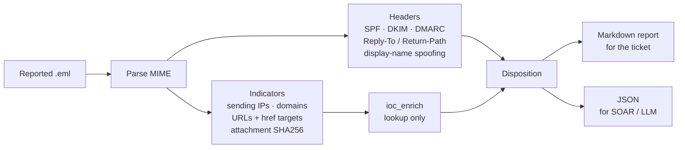

# Use cases

This page covers where `threat-intel-enrichment` fits in a detection and response workflow. Use case 1 ships as runnable code in [`examples/`](../examples). The others show integration patterns built on the same `enrich()` call.

| # | Use case | Who | Status |
|---|---|---|---|
| 1 | [Reported-phishing triage](#1-reported-phishing-triage) | SOC L1/L2, IR | Runnable: `examples/phishing_triage.py` |
| 2 | [Alert enrichment in SIEM/SOAR](#2-alert-enrichment-in-siemsoar) | Detection engineering | Pattern |
| 3 | [Exploitation-driven vulnerability prioritization](#3-exploitation-driven-vulnerability-prioritization) | Vulnerability management | Pattern |
| 4 | [Tool for an LLM triage agent](#4-tool-for-an-llm-triage-agent) | Security engineering | Pattern |
| 5 | [IOC sweep from threat-intel reports](#5-ioc-sweep-from-threat-intel-reports) | Threat intel, hunting | Pattern |

---

## 1. Reported-phishing triage

**Problem.** User-reported phishing is one of the highest-volume, most repetitive SOC queues. For each message, an analyst checks the authentication headers, pulls the links and attachments, looks each one up in several tools, decides, and writes it all up for the ticket. Most of that is mechanical.

**What `examples/phishing_triage.py` does** with one `.eml` file:



1. **Authentication:** reads SPF, DKIM and DMARC results from `Authentication-Results`.
2. **Header red flags:**
   - Reply-To or Return-Path domain differs from the From domain.
   - The display name impersonates another domain (e.g. `"HR (payroll.corp.com)" <x@other.example>`).
   - Link text shows one domain while the link goes to another.
   - The attachment has a high-risk type (`.html`, `.iso`, `.lnk`, `.one`, macro-enabled Office, scripts).
3. **Indicator extraction:**
   - Public originating IPs from `Received` headers; internal relays are dropped.
   - Sender, Reply-To and Return-Path domains.
   - URLs from the plain-text and HTML bodies, including `href` targets and defanged links.
   - URL hosts.
   - Attachment hashes, computed locally.
4. **Enrichment** of every indicator through `ioc_enrich`. Attachments are hashed and looked up, never uploaded.
5. **Disposition** (`MALICIOUS`, `SUSPICIOUS`, `UNDETERMINED`, `NO KNOWN THREAT`), with an ATT&CK mapping and recommended containment actions.

**Run it**

```bash
python3 examples/phishing_triage.py examples/samples/payroll_phish.eml
python3 examples/phishing_triage.py reported.eml --md ticket.md --json triage.json
python3 examples/phishing_triage.py reported.eml --no-enrich     # headers only, no network calls
```

Exit code `2` means MALICIOUS, so a SOAR playbook can branch on it directly.

**Sample.** [`examples/samples/payroll_phish.eml`](../examples/samples/payroll_phish.eml) is a fictional payroll-update lure. It combines a DMARC failure, a free-mail Reply-To, a display name impersonating the company, a link whose text shows the corporate domain but leads elsewhere, and an HTML attachment. [`payroll_phish_report.md`](../examples/samples/payroll_phish_report.md) shows the full report, generated with mocked provider responses.

**Disposition logic**

| Disposition | When |
|---|---|
| MALICIOUS | Any indicator enriches as malicious. |
| SUSPICIOUS | Any indicator is suspicious, or the header flag score is ≥ 4 (DMARC fail, Reply-To mismatch, display-name spoofing, deceptive links and risky attachments score 2; SPF/DKIM failures and Return-Path mismatch score 1). |
| UNDETERMINED | No enrichment source answered. Never closed automatically. |
| NO KNOWN THREAT | Nothing flagged. The report states that absence from threat feeds is not proof of safety. |

**ATT&CK mapping**

| Technique | Mapped when |
|---|---|
| T1566.002 Spearphishing Link | The message contains URLs. |
| T1566.001 Spearphishing Attachment | The message has attachments. |
| T1036 Masquerading | A deceptive link or display-name spoofing is present. |
| T1598.003 Phishing for Information | Provider tags indicate credential phishing. |

**Safety properties**
- Internal relay IPs never leave the host.
- Attachments are never uploaded.
- All indicators in the Markdown report are defanged.
- When sources are unreachable the result is UNDETERMINED, never clean.

**Where it fits**
- **Phishing mailbox automation:** a mail rule or Graph/Gmail API poller saves reported messages as `.eml` and runs the script. The Markdown goes into the ticket and the JSON drives the SOAR branch (auto-purge on MALICIOUS, analyst queue on SUSPICIOUS).
- **Analyst desktop:** drag in an `.eml` and get a ticket-ready write-up in seconds.

**Production hardening.** Add caching (the same campaign hits many mailboxes), a URL cap per message to protect API quotas (the default is 15), sandbox detonation for SUSPICIOUS results through an approved internal service, and campaign clustering by sender and subject.

---

## 2. Alert enrichment in SIEM/SOAR

**Problem.** A detection fires on an outbound connection or a DNS query. The analyst needs reputation context before deciding whether to escalate.

**Pattern.** Call `enrich()` from the playbook step and attach `verdict`, `confidence`, `tags` and `summary` to the alert. Route on the verdict:

```python
import ioc_enrich

def enrich_alert(alert: dict) -> dict:
    r = ioc_enrich.enrich(alert["dest_ip"])
    alert["ti"] = {k: r.get(k) for k in ("verdict", "confidence", "tags", "summary")}
    alert["route"] = {"malicious": "escalate", "suspicious": "analyst",
                      "undetermined": "analyst"}.get(r["verdict"], "auto-close-candidate")
    return alert
```

GreyNoise RIOT and benign classifications are useful for suppressing false positives on CDNs, SaaS providers and resolvers. That is often the biggest triage-time win.

---

## 3. Exploitation-driven vulnerability prioritization

**Problem.** Scanner output lists thousands of CVEs ranked by CVSS. CVSS measures severity, not the likelihood of exploitation.

**Pattern.** Feed the CVE list through the tool and sort by `priority`. KEV membership (P1) reflects confirmed exploitation in the wild. EPSS adds the probability of exploitation over the next 30 days.

```bash
cut -d, -f3 scanner_export.csv | grep -E '^CVE-' | sort -u \
  | python3 ioc_enrich.py - --format jsonl --no-findings \
  | jq -r '[.priority, .indicator, .summary] | @tsv' | sort
```

The CISA KEV catalog is downloaded once per run, so large CVE lists don't hit it repeatedly. The NVD keyless rate limit is low; set `NVD_API_KEY` for bulk runs.

---

## 4. Tool for an LLM triage agent

**Problem.** An LLM assistant drafting triage notes will hallucinate reputation verdicts if it has to rely on its training data.

**Pattern.** Expose `enrich_ioc(indicators)` as a tool (schema in the [README](../README.md#llm-agent-tool-call)). The model gets grounded, source-attributed verdicts. The `summary` field is written to be read verbatim in the model's context.

Guardrails to carry into the system prompt:
- Treat `undetermined` as "needs review", never as clean.
- Never infer maliciousness beyond what the sources report.
- Cite `reference` links in the write-up.

---

## 5. IOC sweep from threat-intel reports

**Problem.** A vendor report or ISAC bulletin lists dozens of indicators. Which are still active, and which are relevant now?

**Pattern.** Paste the indicator list into a file; defanged values are fine. Run it with `--format summary` to see which indicators current feeds still list. Then hunt in your own telemetry for the ones that are still live.

```bash
python3 ioc_enrich.py -f isac_bulletin_iocs.txt --format summary
```
